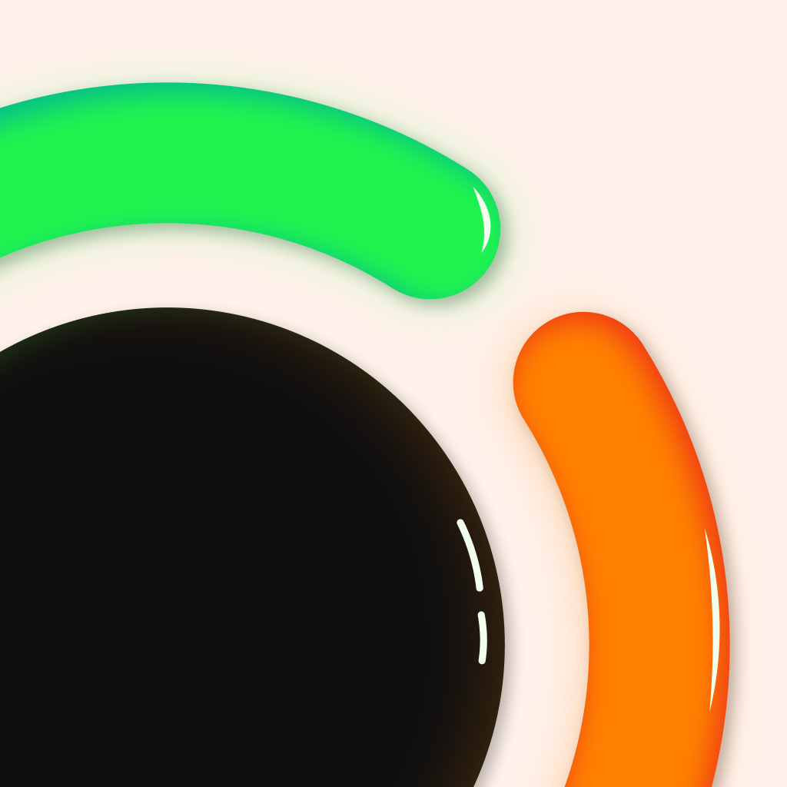
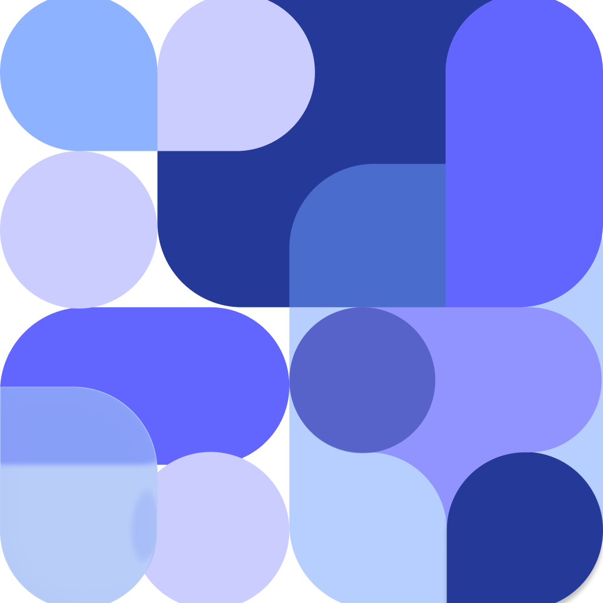
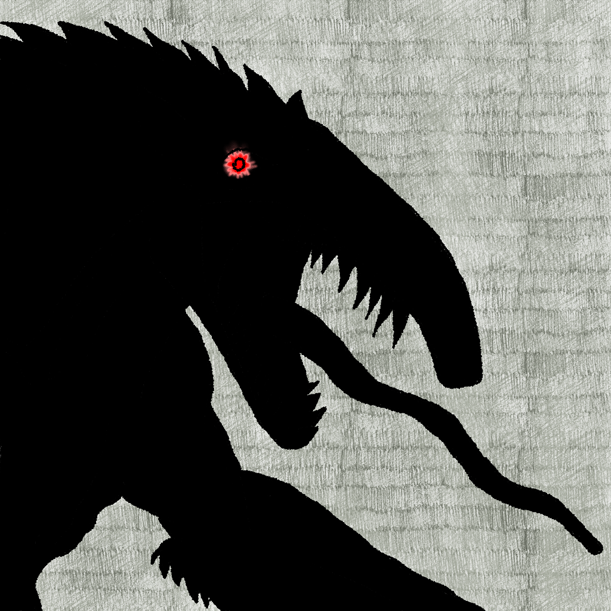
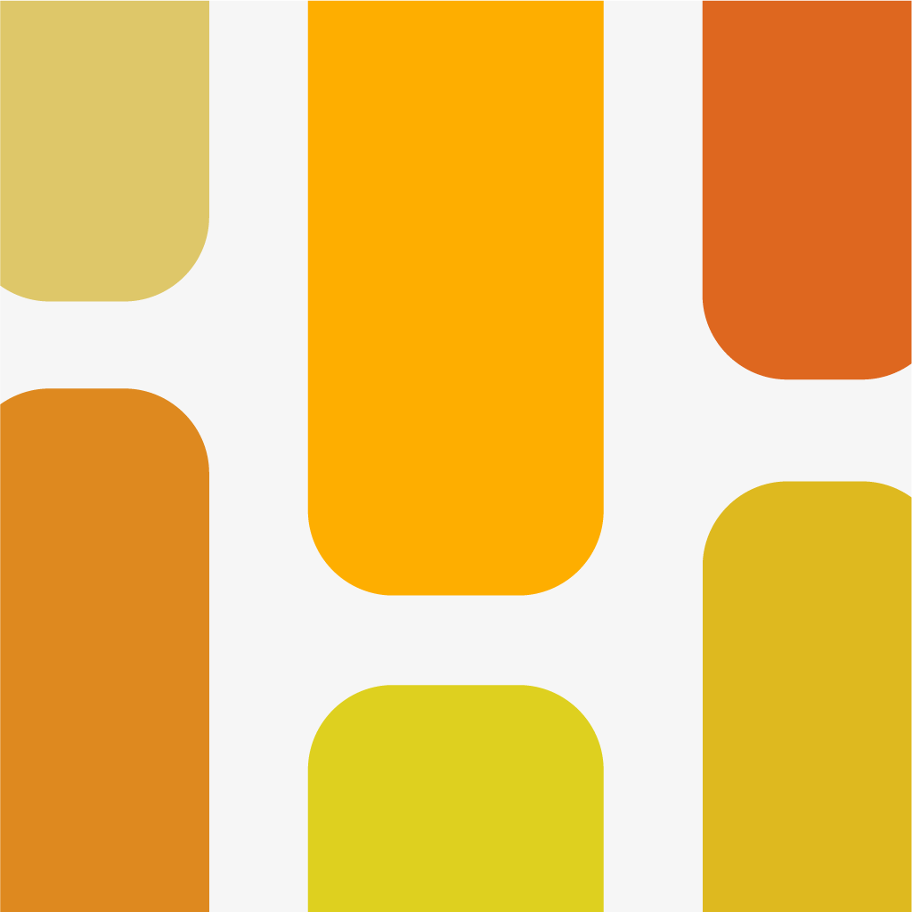
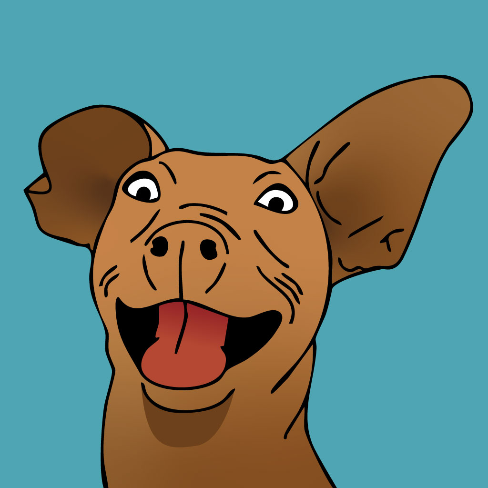
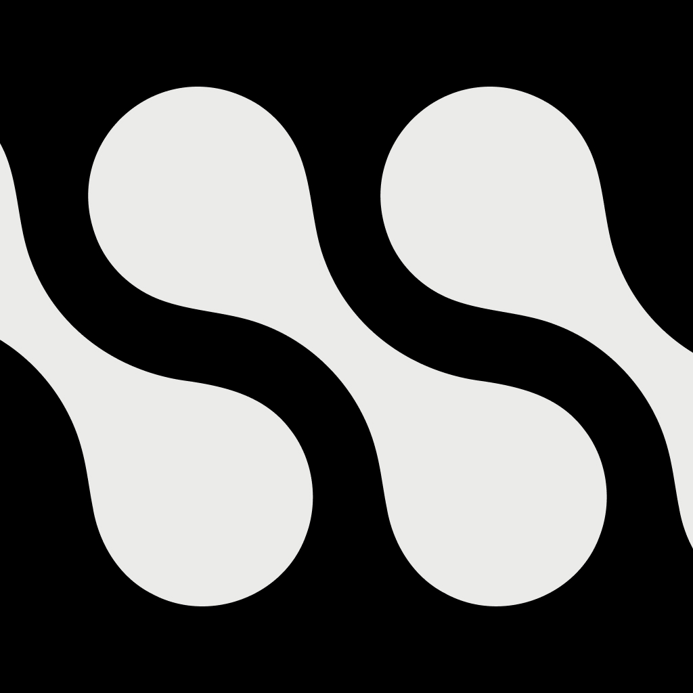
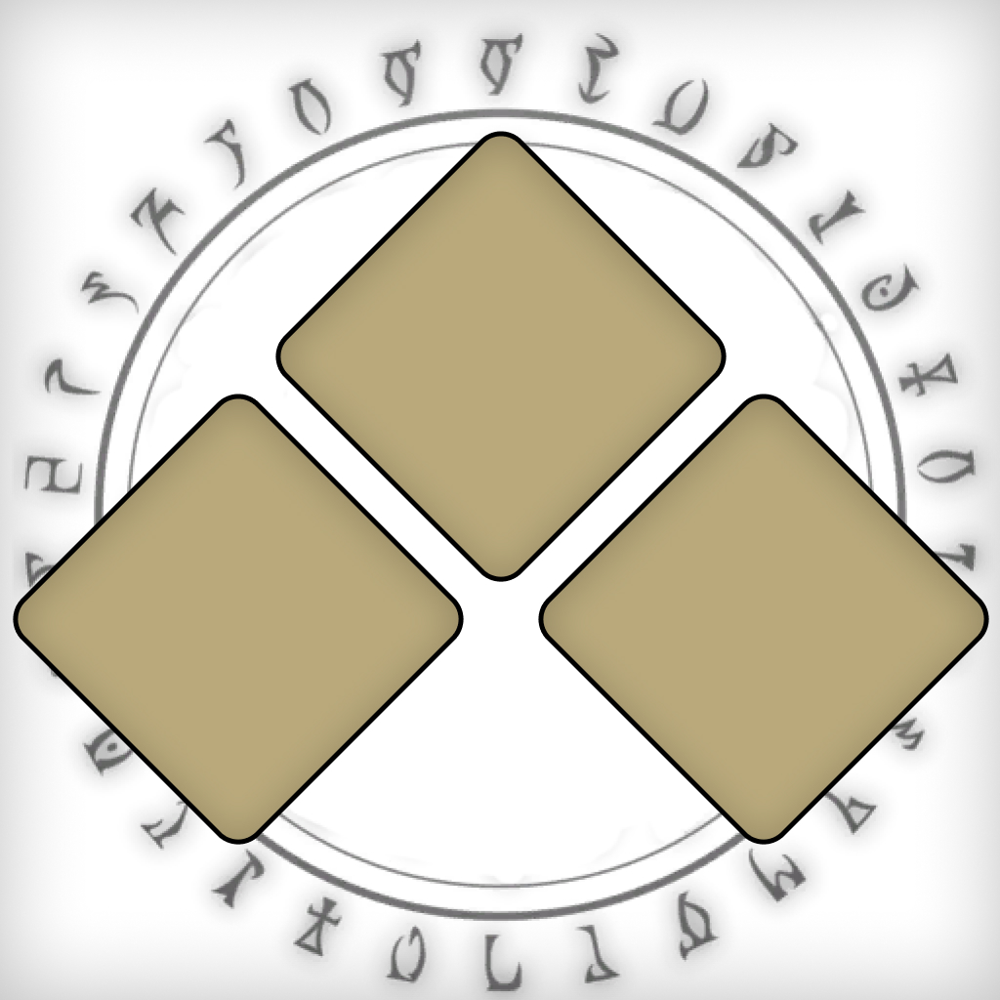
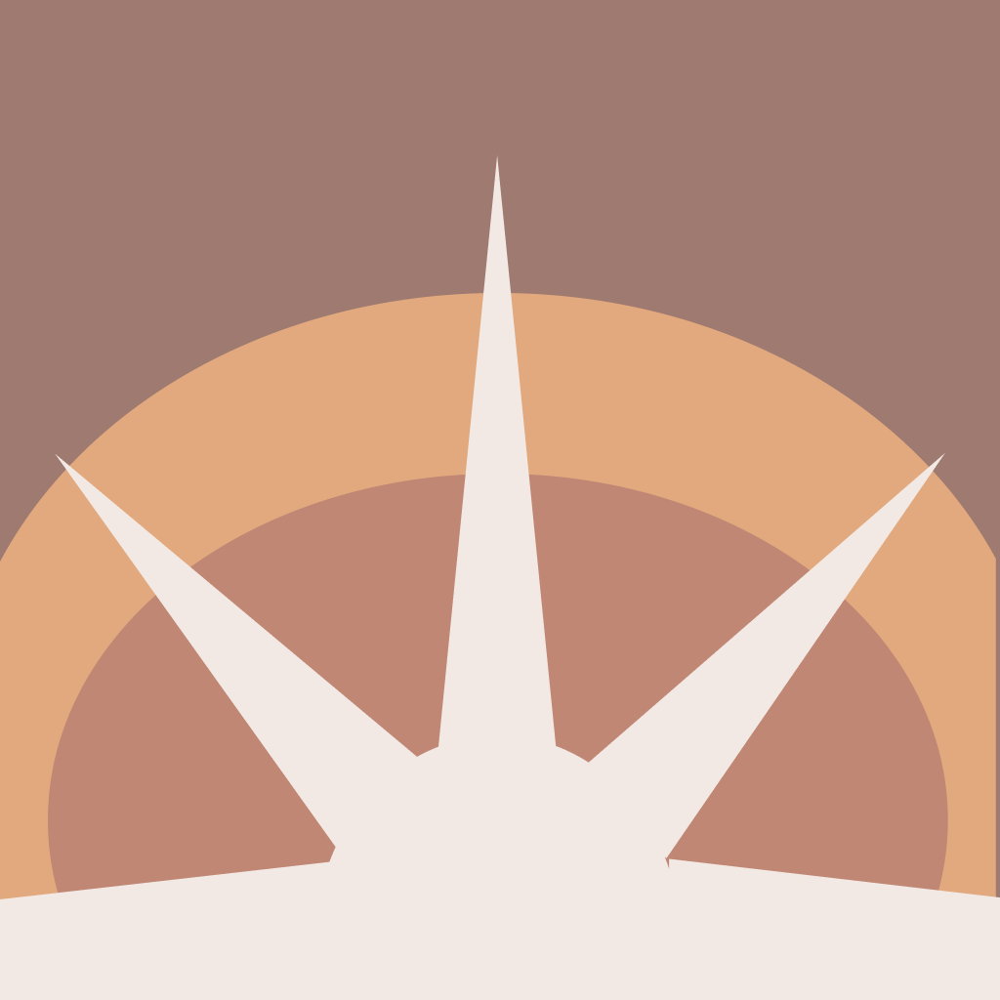
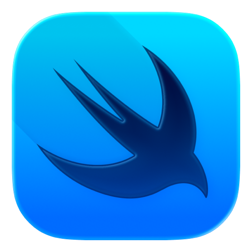
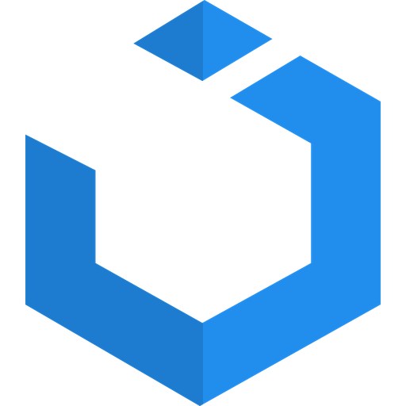

<h2 align="center">iOS Developer | Computer Science Student at Mackenzie Presbyterian University</h2>

    
  

<h2 align="center">Apps on the App Store</h2>

  <table width="100%">
    <tr>
      <td align="center" valign="top" colspan="2" width="33%">
        
        <h4>Reef: Reference Library</h4>
        
        
      </td>
      <td align="center" valign="top" colspan="2" width="33%">
        
        <h4>ReUne!  </h4>
        
        
      </td>
      <td align="center" valign="top" colspan="2" width="33%">
        
        <h4>Causos Ocultos: Quixeramobim</h4>
        
        
      </td>
    </tr>
    <tr>
      <td align="center" valign="top" colspan="2" width="33%">
        
        <h4>MyBoard  </h4>
        
        
      </td>
      <td align="center" valign="top" colspan="2" width="33%">
        
        <h4>NotADiary  </h4>
        
        
      </td>
      <td align="center" valign="top" colspan="2" width="33%">
        
        <h4>Soundstain  </h4>
        
        
      </td>
    </tr>
    <tr>
      <td colspan="1" width="16.5%"></td>
      <td align="center" valign="top" colspan="2" width="33%">
        
        <h4>EsoBuilds  </h4>
        
        
      </td>
      <td align="center" valign="top" colspan="2" width="33%">
        
        <h4>NorthWind  </h4>
        
        
      </td>
      <td colspan="1" width="16.5%"></td>
    </tr>
  </table>

<h2 align="center"> Some Tools I Have Used and Learned</h2>

 

    
<!--

<!--

 -->

 

  
  
  

